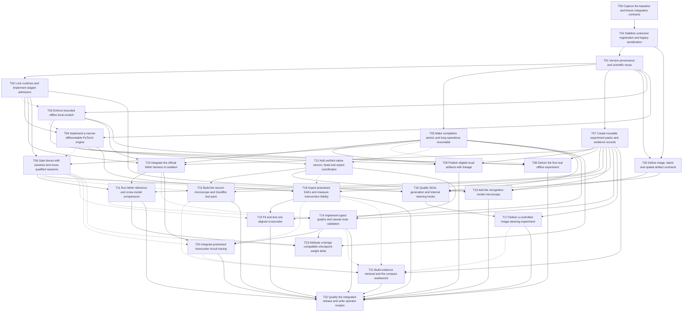

# Complete task dependency graph

Solid edges are start prerequisites; dashed edges are integration prerequisites. Both must be satisfied for acceptance. Shared-file locks are listed in graph.json and EXECUTOR_GUIDE.md.

The adjacency lists in [graph.json](graph.json) are authoritative. T23 is conditional and outside the release gate.
