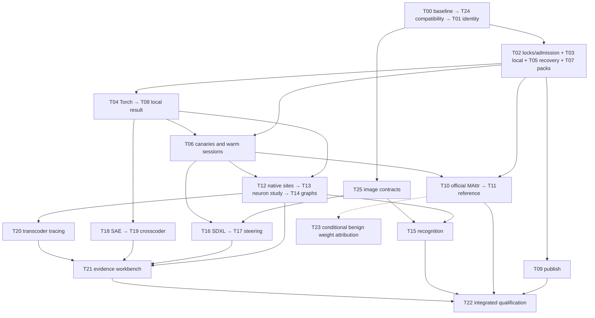

# Research hub execution plan

> Historical build plan (2026-10-16). Start new work from the [experiment guide](../../LLM_RESEARCH.md). Current deferrals are in [BACKBURNER.md](../../BACKBURNER.md). Task checklists here are design history, not a current queue.

**26 executable work packages: 25 for the release, plus one conditional weight-attribution follow-on.** Start with compatibility and provenance, deliver the real local experiment, then advance attribution, native-neuron and vision work in parallel. Learned features and the compact evidence workbench follow their respective adapters. Each task has a separate implementer-ready plan with outputs, source anchors, implementation steps, tests, live acceptance gates and bounded compute.

The tasks are units of ownership and verification, not calendar estimates or promises of one PR each. Multi-part tasks should use the ordered steps as incremental PR boundaries while retaining one acceptance receipt. The user does not need to review another design round; implementers resolve ordinary choices and supply evidence.

**Current execution scope:** deliver the capabilities and verify their plumbing
with small real-model examples. Full paper reproductions, held-out scientific
campaigns and research-quality conclusions are follow-on work. Prefer an obvious
strong intervention and a quick readable comparison when it establishes that a
feature works. Do not tune the research or expand its evaluation to close an
engineering task; keep smoke evidence and scientific validation clearly distinct.
This scope refinement governs the research-heavy steps in the individual plans.

**Current priority:** LLM capabilities. Image generation, steering and recognition
have sufficient initial plumbing proof; do not expand image experiments or tune
their quality. Prioritize text-model attribution, native sites, SAE/crosscoder
interventions, pretrained-transcoder tracing and usable evidence retrieval.

## Start here

See [implementation status](STATUS.md) for capabilities already exercised and
the remaining qualification boundaries.

- Dispatch [T00 baseline](tasks/T00.md), then [T24 compatibility](tasks/T24.md), then [T01 provenance](tasks/T01.md).
- After those, T02 admission/locks, T03 local scratch, T05 recovery, T07 packs and T25 image contracts can proceed on separate modules with the shared-file locks below.
- First usable result is [T08 real offline experiment](tasks/T08.md). The small official MAttr adapter [T10](tasks/T10.md) can progress without waiting for native neurons or a native MAttr rewrite.
- SDXL [T16](tasks/T16.md) proceeds independently of recognition [T15](tasks/T15.md) and graph tools. It waits for common image contracts and runtime qualification, not for those research features.

Give an implementation model one task file plus [EXECUTOR_GUIDE.md](EXECUTOR_GUIDE.md), [CONTRACTS.md](CONTRACTS.md), and its predecessor receipts. That is the handoff; the earlier chat and ignored Planbridge files are not required.

## Delivery gates

| Gate | Demonstrated outcome | Terminal tasks |
| --- | --- | --- |
| M1 | Real pretrained local capture/intervention/report with cloud calls disabled | T08 |
| M2 | Qualified Modal execution, safe recovery/publication, official MAttr reference and cross-model comparison | T06, T09, T11 |
| M3 | Neuron explanation/intervention study, route graph, recognition microscope and held-out SDXL steering | T13, T14, T15, T17 |
| M4 | Pretrained SAE fidelity, aligned crosscoder, transcoder graph and evidence views | T18, T19, T20, T21 |
| M5 | Integrated support matrix and reproducible operator recipes | T22 |

These gates can overlap; M3 vision does not wait for all of M2 attribution. A negative scientific result can satisfy an experiment task. Missing live verification cannot satisfy a capability gate.

## Execution graph

The overview below shows lanes; [the complete graph](DAG.md) includes every task and dependency. [graph.json](graph.json) is the machine-readable dispatch source. Task IDs are stable, not numeric execution order.

Overview arrows combine dependencies for readability and are not scheduling rules. The task table and graph.json are authoritative. `start_after` predecessors must be accepted before work starts. `integration_requires` predecessors may be unfinished during fixture-based development, but must be accepted before task closure. Both sets form an acyclic acceptance graph. Integration locks serialize shared-file changes even for otherwise parallel tasks.

## Task index

| Task | Outcome | Start after | Also required to accept |
| --- | --- | --- | --- |
| [T00](tasks/T00.md) | Capture the baseline and freeze integration contracts | — | — |
| [T24](tasks/T24.md) | Stabilize extension registration and legacy serialization | T00 | — |
| [T01](tasks/T01.md) | Version provenance and scientific reuse | T24 | — |
| [T02](tasks/T02.md) | Lock runtimes and implement staged admission | T01 | — |
| [T05](tasks/T05.md) | Make completion atomic and long operations resumable | T01 | — |
| [T07](tasks/T07.md) | Create reusable experiment packs and evidence records | T01 | — |
| [T25](tasks/T25.md) | Define image, latent and spatial artifact contracts | T01, T24 | — |
| [T03](tasks/T03.md) | Enforce bounded offline local scratch | T01 | T02 |
| [T04](tasks/T04.md) | Implement a narrow differentiable PyTorch engine | T01, T02 | T03 |
| [T09](tasks/T09.md) | Publish eligible local artifacts with lineage | T03, T05, T07 | — |
| [T10](tasks/T10.md) | Integrate the official MAttr harness in isolation | T02, T03, T05, T07 | — |
| [T06](tasks/T06.md) | Gate fanout with canaries and reuse qualified sessions | T02, T05 | T04 |
| [T08](tasks/T08.md) | Deliver the first real offline experiment | T03, T04, T07 | T05 |
| [T12](tasks/T12.md) | Add verified native neuron, head and expert coordinates | T04 | T05 |
| [T11](tasks/T11.md) | Run MAttr reference and cross-model comparisons | T10, T06, T07 | — |
| [T13](tasks/T13.md) | Build the neuron microscope and Goodfire test pack | T12, T07 | T06 |
| [T15](tasks/T15.md) | Add the recognition-model microscope | T12, T07, T25 | T06 |
| [T16](tasks/T16.md) | Qualify SDXL generation and internal steering hooks | T02, T05, T25 | T06 |
| [T18](tasks/T18.md) | Import pretrained SAEs and measure intervention fidelity | T04, T07 | T12, T06 |
| [T14](tasks/T14.md) | Implement typed graphs and causal route validation | T07, T12 | T10, T11 |
| [T17](tasks/T17.md) | Deliver a controlled image-steering experiment | T16, T07 | — |
| [T19](tasks/T19.md) | Fit and test one aligned crosscoder | T18, T05 | T06 |
| [T20](tasks/T20.md) | Integrate pretrained transcoder circuit tracing | T10, T14 | T06, T18 |
| [T23](tasks/T23.md) | Attribute a benign compatible checkpoint weight delta | T11, T14, T05 | T06 |
| [T21](tasks/T21.md) | Build evidence retrieval and the compact workbench | T07 | T13, T14, T17, T18, T20 |
| [T22](tasks/T22.md) | Qualify the integrated release and write operator recipes | T08, T09, T11, T13, T14, T15, T17, T18, T19, T20, T21 | — |

## Dispatch and scope

Use a capable implementation model per active lane and one integrator for shared contracts/files. Do not launch all 26 tasks at once. Start only graph-ready tasks; independent module/fixture work can overlap, while the [shared-file lock table](EXECUTOR_GUIDE.md#shared-file-integration-discipline) controls conflicting changes. Reviewer checks include test evidence and scientific semantics, not just code style. No additional user plan review is a dependency.

Every new operation must integrate serialization, capability checks, planning, local/remote dispatch, typed artifacts, identity and recovery. Runtime environments remain separate: vLLM, native PyTorch, official MAttr, Diffusers and external learned-feature tools. Existing workflows and historical manifests remain readable. No second scheduler or run database is introduced.

External access, numerical equivalence and memory fit are executable qualification tasks, not assumptions. A model cannot mark a live gate passed because fixtures work. It completes independent code/tests, records an exact blocker, and continues other ready tasks. Scientific nulls are accepted results; invented model access or successful effects are not.

Deferred beyond this release: native MAttr rewrite, general training/RL, large dictionary campaigns, developmental retraining, FLUX, broad model/device coverage and a hosted dashboard rebuild. [T23](tasks/T23.md) is a fully specified conditional extension requiring a suitable benign checkpoint pair; it does not block T22.

## Supporting documents

- [Executor guide](EXECUTOR_GUIDE.md): dispatch, review, integration locks, evidence receipt and failure policy.
- [Shared contracts](CONTRACTS.md): exact field meanings, invariants and producers/consumers.
- [Sources and baseline](SOURCES.md): papers, official integrations and current-code constraints.
- [Review dispositions](REVIEW.md): Codex/Claude decisions and final review status.
- [Original concise roadmap](../RESEARCH_HUB_PLAN.md).

This package specifies future work. It does not assert that any planned capability or qualification has been implemented.

Validate the package without executing tasks: `python3 platform/research_hub_execution/validate_plan.py`.
